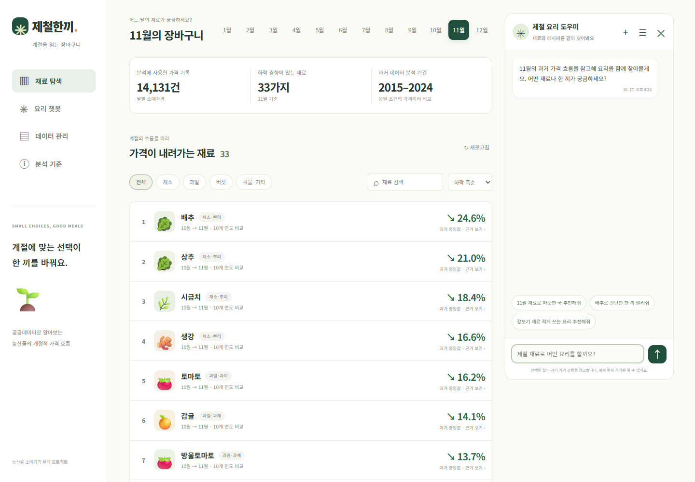
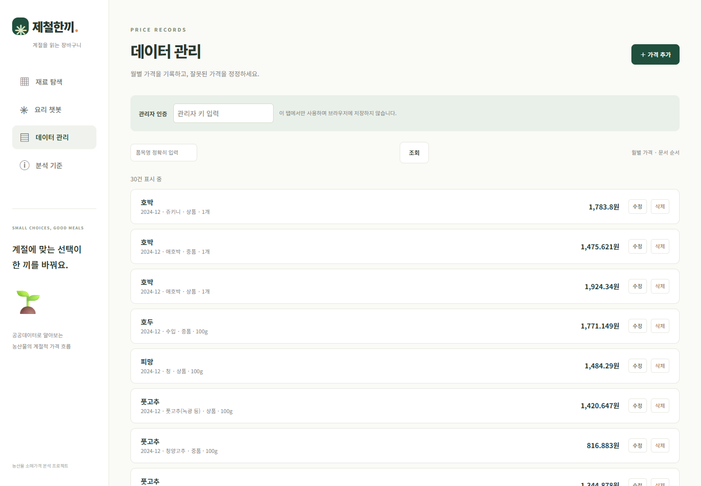
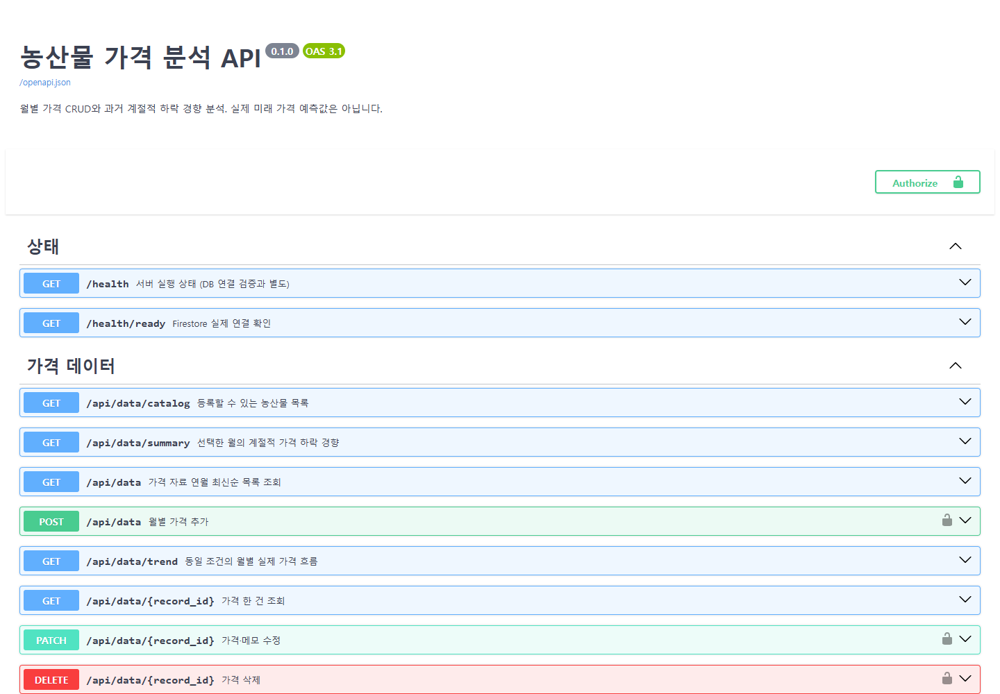
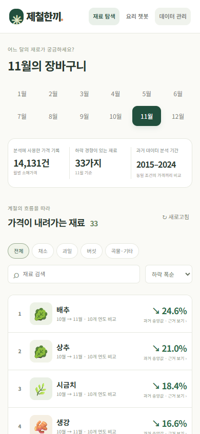
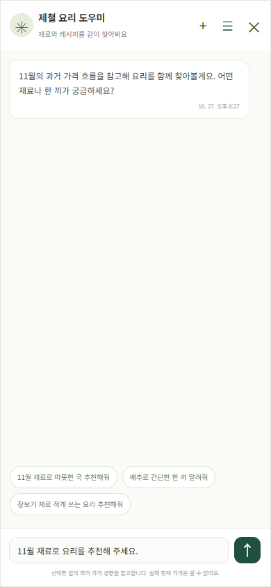

# 제철한끼 — 농산물 가격 분석과 요리 추천

공공기관의 월별 농산물 소매가격을 분석해 **특정 달에 가격이 내려가는 경향이 있는 재료**를 보여주고, 그 재료를 활용한 요리를 추천하는 웹 서비스입니다.

현재 가장 싼 재료를 찾거나 미래 가격을 확정적으로 예측하는 서비스는 아닙니다. 과거의 계절적 경향을 분석합니다.

**Vercel 프론트엔드 배포 완료: https://cod-m1-2-frontend.vercel.app**

## 실제 실행 화면과 검증 증빙

2026-10-27 배포 사이트를 Chrome으로 직접 캡처했습니다. 미리보기·목업 화면이 아닙니다.
이미지 외에도 자동 평가에서 읽을 수 있는 [실제 HTTP 응답·CRUD 로그·모바일 동작 기록](reports/deployment_evidence.md)을 제공합니다.

| 확인 항목 | 실제 확인 결과 | 증빙 |
| --- | --- | --- |
| 공개 배포 접속 | Render `/health` 200, Vercel 화면에 가격 14,131건·11월 후보 33개 표시 | 아래 재료 탐색 캡처와 [접속 로그](reports/deployment_evidence.md#배포-접속과-swagger) |
| Swagger | 공개 `/docs` 화면 로딩, `/openapi.json` 200 | 아래 Swagger 캡처와 OpenAPI 응답 발췌 |
| Firestore 저장·조회 | POST 201 → PATCH 200 → GET 200 → DELETE 204 → GET 404 | [실제 CRUD 검증 기록](reports/deployment_evidence.md#실제-가격-crud-검증)과 아래 최신순 목록 캡처 |
| 모바일 화면 | 390×844에서 탐색·채팅 열기·입력·닫기, 가로 넘침 없음 | 아래 모바일 캡처와 [동작 기록](reports/deployment_evidence.md#모바일-화면-검증) |

### 재료 탐색 — 실제 배포 화면



1440×1000 화면. 오른쪽 메시지는 챗봇의 초기 안내이며 AI 답변 생성 증빙은 아닙니다.

### 데이터 관리 — 실제 Firestore 목록



인덱스 활성화 후 배포 사이트에서 목록이 정상 표시되는 화면입니다. 관리자 키는 입력하지 않았으며 비밀값은 포함하지 않았습니다.

### Swagger — 배포 백엔드 API 문서



접속 주소: https://geogyfood.onrender.com/docs. 실제 OpenAPI 응답의 버전은 `3.1.0`, 앱 버전은 `0.1.0`입니다.

### 모바일 — 재료 탐색과 채팅 패널

 

Chrome의 390×844 CSS 픽셀 뷰포트로 확인했습니다. 실물 휴대전화 테스트와 구분합니다. 입력은 확인하되 비용 절감을 위해 메시지는 전송하지 않았습니다.

## 현재 진행 상황

2026-10-27 기준입니다. 아래의 실제 API 검증, 사용자 확인, 로컬 테스트 결과를 구분해 기록합니다.

| 구분 | 상태 |
| --- | --- |
| 데이터 정리 | 공공 CSV 6개 통합, 중복·가격 충돌·연월 이상 분리 |
| 선별 자료 | 농산물 64개 품목, 36,169행 중 분석 기간에 해당하는 자료 사용 |
| Firestore 초기 적재 | 사용자가 실제 연결 및 가격 기록 14,131건 적재 확인 |
| 요약 API | 실제 Firestore 기반 분석 응답 확인 |
| 웹 화면 | 아이콘 목록, 월 선택, 검색·정렬, 가격 비교 탭, CRUD, 챗봇 구현. 사용자가 실제 화면에서 가격 기록 14,131건, 후보 33개, 분석 기간 2015–2024와 재료 순위 표시 확인 |
| AI·대화 | 기관 AI API 연동 적용. 대화 저장·불러오기는 사용자 동작 확인 완료. 이번 최종 검증에서는 유료 AI를 재호출하지 않음 |
| AI 요청 설정 | `https://copa.codyssey.kr/v1/chat/completions`, 모델 `gpt-5-mini`, 본문은 `model`·`messages`만 전송, `OPENAI_API_KEY`로 Bearer 인증 |
| 가격 CRUD | 배포 API에서 임시 가격 등록·수정·조회·삭제 성공, 중복 등록 409와 삭제 후 404 확인. 테스트 기록 삭제 완료 |
| 분석 캐시 | 가격 변경과 revision 갱신을 원자적으로 처리. 중복 등록 실패 시 revision 유지 확인. 실제 Firestore 자료로 revision 11 캐시 저장 완료 |
| 자동 검증 | Python 오프라인 테스트 39개 통과. JavaScript 구문 검사는 이전 작업에서 통과 |
| 조회 안정성 | 분석 원본을 500건씩 커서 조회하도록 수정. 시간 초과는 `503 / firestore_timeout`, 할당량 초과는 `503 / firestore_quota_exceeded`로 구분 |
| 화면 개선 | 데이터 목록 최신 연월순 정렬·인덱스 활성화 후 실제 목록 확인. 모바일 채팅 고정 패널을 배포 사이트의 390×844 뷰포트에서 열기·입력·닫기 검증 및 캡처 |
| 배포 | Vercel 프론트·Render 백엔드 연결 확인. 프론트 재료 목록 64개, 양쪽 요약 API 200 응답 확인 |

모의 테스트 통과와 실제 클라우드 연동 성공은 구분합니다. 인증키와 서비스 계정 비밀값은 이 문서에 기록하지 않습니다.

## 배포 주소

| 주소 | 내용 |
| --- | --- |
| [Vercel 프론트엔드](https://cod-m1-2-frontend.vercel.app) | 사용자용 웹 화면 |
| [Render 백엔드](https://geogyfood.onrender.com) | FastAPI 서버·정적 앱 |
| [/docs](https://geogyfood.onrender.com/docs) | Swagger API 문서·요청 실행 |
| [/health](https://geogyfood.onrender.com/health) | DB 조회 없이 서버 실행 상태 확인 |
| [/health/ready](https://geogyfood.onrender.com/health/ready) | 실제 Firestore 연결 확인: 읽기 요청 발생 |
| [/api/data/summary?month=11](https://geogyfood.onrender.com/api/data/summary?month=11) | 11월 계절적 하락 경향 요약 |

`frontend/vercel.json`의 `/api/:path*` rewrite가 Render로 요청을 전달합니다.
최종 확인에서 백엔드와 Vercel 경유 요약 모두 가격 기록 **14,131건**, 11월 후보 **33개**, 동일한 캐시 생성 시각을 반환했습니다.
대화 저장·불러오기는 사용자 확인 결과이며, 실제 모바일 기기 전체 동작을 자동 검증한 것은 아닙니다.

## 로컬 실행

PowerShell에서 실행합니다.

```powershell
cd C:\cod-M1-2
```

새 환경이라면 가상환경과 패키지를 준비합니다. 기존 환경은 다시 만들 필요가 없습니다.

```powershell
python -m venv .venv
.\.venv\Scripts\python.exe -m pip install -r requirements-dev.txt
```

설정 파일이 없는 경우에만 복사합니다. 기존 설정을 덮어쓰지 않습니다.

```powershell
if (-not (Test-Path .env)) { Copy-Item .env.example .env }
```

| 환경 변수 | 용도 |
| --- | --- |
| `FIREBASE_PROJECT_ID` | Firebase 프로젝트 |
| `GOOGLE_APPLICATION_CREDENTIALS` | 로컬 서비스 계정 JSON 파일 경로 |
| `FIRESTORE_DATABASE` | 기본값 `(default)` |
| `ADMIN_API_KEY` | 가격 추가·수정·삭제용 관리자 키 |
| `OPENAI_API_KEY` | 기관 AI API의 Bearer 인증 키. 변수명은 기존 이름 유지 |
| `OPENAI_MODEL` | 기본 모델 `gpt-5-mini` |
| `ALLOWED_ORIGINS` | 허용할 프론트엔드 출처. 배포 시 실제 Vercel 도메인 지정 |
| `ANALYSIS_START_YEAR` / `ANALYSIS_END_YEAR` | 기본 분석 기간 `2015` / `2024` |
| `ANALYSIS_MIN_YEARS` | 최소 비교 연도 수, 기본 `5` |

실제 Firestore를 사용할 때 `FIRESTORE_EMULATOR_HOST`는 비워 둡니다.
비밀값은 `frontend/`나 Git에 넣지 않습니다. `.env` 변경 후 서버를 재시작합니다.
배포 API에 가격 쓰기 요청을 보낼 때는 Render에 설정된 `ADMIN_API_KEY`와 같은 값을 사용해야 합니다. 불일치하면 401 응답이 반환됩니다.

```powershell
.\.venv\Scripts\python.exe -m uvicorn app.main:app --host 127.0.0.1 --port 8001 --reload
```

| 주소 | 내용 |
| --- | --- |
| http://127.0.0.1:8001/ | 실제 앱 |
| http://127.0.0.1:8001/docs | Swagger API 문서·요청 실행 |
| http://127.0.0.1:8001/?preview=1 | CSV 기반 분석·그래프 미리보기 |
| http://127.0.0.1:8001/mockup.html | 독립 HTML 디자인 목업 |
| http://127.0.0.1:8001/health | 서버 상태·설정 여부 |
| http://127.0.0.1:8001/health/ready | 실제 Firestore 연결 확인: 읽기 요청 발생 |
| http://127.0.0.1:8001/api/chat/status | AI 키 설정 여부. 실제 AI 연결 검사는 아님 |

화면 변경이 보이지 않으면 `Ctrl+F5`로 새로고침합니다.

## 실제 앱·미리보기·목업의 차이

| 모드 | 자료 | 저장·AI 동작 |
| --- | --- | --- |
| 실제 앱 `/` | Firestore와 서버 분석 결과 | 실제 CRUD·AI 호출·Firestore 대화 저장 |
| 미리보기 `/?preview=1` | 정제 CSV에서 생성한 분석·가격 파일 | 가격 변경·AI 전송 불가. 현재 Firestore 결과가 아님 |
| 목업 `/mockup.html` | 디자인 예시. 그래프 가격은 가상 값 | 고정 AI 예시 답변, 대화·CRUD는 현재 브라우저에 저장 |

목업의 브라우저 기록은 실제 앱의 Firestore 기록으로 옮겨지지 않습니다.

## 화면 기능

- **재료 탐색:** 1~12월 선택, 분류·검색·정렬, 아이콘 목록형 순위.
- **상세 탭:** 기본은 월별 가격 비교. 연도별 탭은 선택한 같은 달의 각 연도 가격을 비교합니다.
- **그래프:** 품종·등급·판매 수량·단위를 분리합니다. 월별은 해당 조건의 최근 관측 연도이며 결측치를 임의로 채우지 않습니다. 원 단위 가격·표·간단한 설명을 제공합니다.
- **데이터 관리:** 최신 연월순 목록·품목 검색·커서 페이지 조회, 관리자 키를 사용한 추가·수정·삭제. 같은 연월은 생성 시각·문서 ID 내림차순으로 정렬합니다. 수정 대상은 가격·메모입니다.
- **챗봇:** 오른쪽 패널, 모바일에서는 고정 패널, `+` 새 대화, `☰` 목록, 특정 대화 불러오기. 실제 저장 성공 후 안내합니다.
- **닫기:** 상세·편집 창은 Esc 또는 배경 클릭, 챗봇은 Esc·바깥 클릭·×로 닫고 메뉴에서 다시 엽니다.
- **로딩:** 가격 스켈레톤·지연 안내, AI 응답 대기 애니메이션, 중복 전송 방지와 오류 표시.

## 시계열 분석 → 요약 → 서비스 활용

시계열 데이터는 **시간 순서대로 쌓인 기록**입니다. 이 프로젝트에서는 농산물의 연월과 소매가격 기록을 사용합니다.

```text
공공 CSV → 정리·검증 → Firestore 가격 기록
                         ↓
             같은 조건의 전월·선택 월 비교
                         ↓
             각 해의 변화율 → 여러 해의 요약
                         ↓
                /api/data/summary
                    ↙          ↘
                재료 순위     AI 요리 추천 참고 정보
```

1. 한국농수산식품유통공사의 월별 농축수산물 소매가격 CSV를 통합하고 농산물을 선별합니다.
2. 같은 품목·품종·등급·판매 수량·단위의 전월과 대상 월 가격을 비교합니다.
3. `(대상 월 가격 ÷ 전월 가격 − 1) × 100`으로 변화율을 계산합니다. 1월은 전년도 12월과 비교합니다.
4. 품목·연도별 변화율의 중앙값을 구한 다음 여러 연도의 중앙값을 구합니다. 중앙값은 숫자를 크기순으로 정렬했을 때 가운데 값입니다. 기록이 많은 해에만 결과가 치우치지 않도록 합니다.
5. 비교 연도 5년 이상, 하락 연도 비율 60% 이상, 변화율 중앙값 음수, 분석 종료 연도 기준 최근 2년 내 비교 기록이 있는 품목을 후보로 선정합니다.
6. 품목·하락 폭·비교 연도 수·하락 연도 수 등을 요약해 순위와 챗봇에서 활용합니다.

분석 기간은 **2015~2024년**입니다. 2015년 1월 비교를 위해 **2014년 12월**도 읽습니다.
2025년 자료 누락과 2026년 자료의 날짜 확인 문제로 최신 가격은 포함하지 않았습니다.
날씨·공급·수요·물가 상승률을 반영하지 않았으며 수입 농산물도 포함합니다.

발표 예시:

> 공공데이터의 월별 농산물 가격을 분석했습니다. 같은 조건의 가격끼리 비교해 특정 달에 가격이 내려가는 경향을 찾고, 하락 폭과 하락한 연도 수로 요약했습니다. 이를 API로 제공해 재료 순위와 AI 요리 추천에 활용하도록 구현했습니다. 과거 경향이므로 앞으로 반드시 싸진다는 뜻은 아닙니다.

## FastAPI와 프로젝트 분리 기준

**FastAPI는 파이썬으로 서버와 API를 만드는 도구**입니다. 웹페이지의 요청을 받아 처리하고 결과를 반환하며 Swagger 문서를 제공합니다.

코드는 **담당하는 일의 책임**에 따라 나눴습니다.

| 위치 | 역할 | 쉬운 비유 |
| --- | --- | --- |
| `app/main.py` | 앱 생성, 라우터 연결, CORS, 오류 처리, 정적 화면 제공 | 전체 운영 |
| `app/routers/` | HTTP 주소·메서드와 담당 서비스 연결 | 주문받는 직원 |
| `app/services/prices.py` | 가격 처리·분석 캐시 | 가격 업무 담당 |
| `app/services/seasonality.py` | 계절적 하락 경향 계산 | 계산 담당 |
| `app/services/trends.py` | 같은 조건의 월별·연도별 가격 자료 구성 | 그래프 자료 담당 |
| `app/services/chat.py` | 요약·이전 대화로 AI 요청 구성, 결과 저장 요청 | 요리 추천 담당 |
| `app/repositories/firestore.py` | Firestore 읽기·쓰기 | 창고 담당 |
| `app/schemas.py` | Pydantic 입력·출력 형식 및 검증 | 주문서 규칙 |
| `app/dependencies.py` | 서비스·저장소 제공, 관리자 인증 | 담당자 연결 |
| `app/config.py` | 환경 변수 로딩 | 운영 설정 |
| `frontend/` | HTML·CSS·JavaScript 화면 | 손님이 보는 공간 |

분석법이 바뀌면 서비스를, 저장 방식이 바뀌면 저장소를 중심으로 수정합니다. 분석 계산은 실제 DB 없이도 테스트할 수 있습니다.

발표 예시:

> 라우터는 요청과 응답을 연결하고, 서비스는 분석과 챗봇의 핵심 처리를 담당합니다. Firestore 접근은 저장소에, 입력·출력 규칙은 스키마에 모았습니다. 변경의 영향을 줄이고 각 역할을 따로 테스트하기 위해 분리했습니다.

## Pydantic 검증의 이유와 방식

**Pydantic은 입력이 정해진 규칙에 맞는지 검사하는 도구**입니다. 잘못된 가격이 저장되면 그래프·순위·AI 참고 요약도 잘못됩니다. 브라우저 검증만으로는 API 직접 요청을 막을 수 없어 서버에서도 검사합니다.

| 입력 | 적용한 규칙 |
| --- | --- |
| 가격 | 0 초과, 최대 10,000,000원, 소수 자릿수 제한, 무한대·NaN 거절 |
| 수량 | 양수, 상한·소수 자릿수 제한 |
| 연월 | `YYYY-MM` 형식, 1996년 이후의 완료된 월 |
| 품목·등급·단위 | 프로젝트가 지원하는 값인지 확인 |
| 가격 입력 문자열 | 공백·유니코드 정리, 제어 문자·HTML 태그 기호 거절 |
| 채팅 질문 | 최대 1,000자, 공백뿐인 질문·NUL 문자 거절 |
| 선택 월 | 1~12. 채팅 스키마 및 조회 파라미터의 FastAPI `Query`에 정의 |
| 정의하지 않은 입력 필드 | 요청 스키마의 `extra="forbid"`로 거절 |

`PriceCreate`, `PriceUpdate`, `ChatRequest` 등에 자료형·필수 항목·범위·검증 함수를 정의했습니다.
FastAPI가 서비스 호출 전에 검증하며 잘못된 요청은 보통 **422** 오류로 반환합니다.
숫자로 해석 가능한 `"3000"`은 변환될 수 있지만 `"삼천원"`이나 음수 가격은 거절합니다.
응답 모델에도 스키마를 지정해 반환 형식을 명확하게 합니다.

발표 예시:

> 데이터 오염과 잘못된 분석을 막기 위해 Pydantic 검증을 적용했습니다. 요청 스키마에 필수 항목, 자료형, 숫자 범위와 글자 수를 정의하고 필요한 항목에는 별도 검증 함수를 추가했습니다. 검증을 통과한 값만 서비스에 전달합니다.

## 요약 주입과 대화 저장

챗봇은 선택 월의 요약에서 상위 후보 최대 8개를 가져와 AI 지침에 참고 정보로 넣습니다.
과거 경향과 현재 가격·미래 확률을 구분하도록 안내하고, 사용자 질문과 최근 대화는 별도 메시지로 전달합니다.

- **장점:** 원본 전체를 보내지 않아 입력량을 줄이고 화면과 챗봇이 같은 분석 기준을 사용합니다.
- **한계:** 요약 밖의 정보와 최신 가격을 알 수 없으며 AI의 정확한 해석을 항상 보장하지는 않습니다.
- **요약 API 분리 이유:** 계산을 재사용하고 분석 기준 변경을 한곳에서 처리합니다.

| 컬렉션 | 주요 내용 | 설계 이유 |
| --- | --- | --- |
| `data` | 연월·품목·품종·등급·가격·수량·단위·출처·시각 | 가격 CRUD·분석. 동일 조건의 중복 기록 방지 |
| `conversations` | 소유자 ID·제목·메시지 배열·생성/수정 시각 | 가격 기록과 분리해 대화 목록·복원 지원 |
| `analysis_cache` | revision, 압축된 summary·trends | 분석 결과를 재사용해 원본 전체 조회 절감 |

정상 AI 응답 후 질문·답변 한 쌍을 트랜잭션으로 저장합니다. AI 실패·불완전 응답은 정상 대화로 저장하지 않으며 저장 실패도 성공으로 표시하지 않습니다.
한 대화에는 최근 100개 메시지를 보관하고 AI 입력에는 이전 메시지 최대 12개를 사용합니다.
브라우저의 임의 소유자 ID로 대화를 구분하지만 정식 로그인 인증을 대체하지 않습니다. 과제 데모를 넘어 공개 서비스를 운영하려면 사용자 인증·호출량 제한 보완이 필요합니다.

## 주요 API

| 메서드·경로 | 용도 |
| --- | --- |
| `GET /api/data/catalog` | 지원 품목 |
| `GET /api/data` | 가격 목록·품목 검색·커서 페이지 |
| `POST /api/data` | 가격 추가 |
| `GET /api/data/{record_id}` | 가격 한 건 |
| `PATCH /api/data/{record_id}` | 가격·메모 수정 |
| `DELETE /api/data/{record_id}` | 삭제 |
| `GET /api/data/summary?month=11` | 계절적 하락 경향 요약 |
| `GET /api/data/trend?item_name=배추` | 월별·연도별 가격 자료 |
| `GET /api/chat/status` | AI 설정 여부 |
| `POST /api/chat` | 요리 질문·대화 저장 |
| `GET /api/conversations?owner_id=...` | 대화 목록 |
| `GET /api/conversations/{id}?owner_id=...` | 특정 대화 복원 |

가격 쓰기 요청에는 `X-Admin-Key`가 필요합니다. 요청·응답 구조는 `/docs`에서 확인합니다.

## Firestore 할당량과 캐시

요약·그래프 분석 결과는 `analysis_cache`의 압축된 `summary`·`trends` 문서와 서버 메모리에 보관합니다.
서버 재시작 후에는 revision 문서 1회와 결과 문서 2회 읽기로 캐시를 불러옵니다. 원본 약 14,000건은 매번 읽지 않습니다.
캐시가 없거나 revision·분석 기간이 다르면 원본을 읽어 분석하고 결과를 다시 저장합니다.
가격 추가는 배치, 수정·삭제는 트랜잭션으로 가격 변경과 revision 증가를 함께 커밋합니다. 저장이 거절되면 revision과 기존 메모리 캐시를 유지하고, 성공하면 해당 서버의 메모리 캐시를 무효화합니다.
CSV 적재도 성공한 각 `create`에 revision 갱신을 포함하므로 중간에 중단되어도 이미 저장된 변경이 반영됩니다. 작업 끝에 별도로 revision을 올리지 않습니다.
Firestore 콘솔에서 직접 바꾼 자료는 revision이 바뀌지 않으므로 관리자 API를 사용하거나 캐시를 갱신해야 합니다.

캐시 재생성 시에는 연월·문서 ID 순으로 **최대 500건씩** 읽습니다. 한 번의 긴 스트림이 30초 제한에 걸리는 문제를 줄이며, 페이지 조회가 실패하면 불완전한 분석 결과를 저장하지 않습니다.
조회에는 `retry=None` 대신 재시도를 끈 명시적 `Retry` 객체를 전달합니다. SDK의 `NoneType._predicate` 오류와 자동 재조회에 따른 추가 읽기를 방지합니다. 시간 초과와 할당량 오류는 각각 구분된 503 응답으로 안내합니다.

최종 검증에서는 중복 등록 실패 시 revision 9가 유지되고, 수정 후 10, 삭제·최종 캐시 확인 시 11이 된 것을 확인했습니다. 기존 전체 조회는 시간 초과로 실패했고, 페이지 조회 수정 후 실제 Firestore 자료 14,131건으로 분석 캐시를 저장했습니다. 프론트·백엔드에서 같은 캐시 결과를 확인했습니다.
revision 11은 이 검증 시점의 값이며 고정 설정값이 아닙니다. 이후 가격 변경 시 증가합니다.

현재 캐시는 복구되어 있으므로 seed를 다시 실행할 필요가 없습니다. 아래 명령은 **Firestore 원본과 기준 CSV가 일치함을 확인한 경우에만** 사용하는 선택적 복구 도구입니다. CSV에는 이후 Firestore 변경분이 없을 수 있으므로 임의로 실행하면 안 됩니다. 최종 검증에서는 이 도구를 실행하지 않았습니다.

```powershell
.\.venv\Scripts\python.exe scripts/seed_analysis_cache.py --write
```

CSV 적재가 필요하면 마지막에 캐시를 한 번 갱신합니다.

```powershell
.\.venv\Scripts\python.exe scripts/import_firestore.py --write --refresh-analysis-cache
```

비용을 줄이려면 원본 재적재·seed·반복 CRUD 검증을 피하고, 여러 가격 변경을 마친 뒤 분석을 한 번 갱신합니다. 캐시가 유효하면 월별 조회는 분석 결과를 재사용합니다. 캐시 미스 시에는 페이지로 나눠 읽더라도 전체 대상 문서의 읽기 비용이 발생합니다. 이 변경 자체가 Firestore 할당량을 복구하는 것은 아닙니다.

## 데이터 처리와 테스트

원본 자료를 다시 정리하거나 미리보기 파일을 재생성할 때 사용합니다.

```powershell
.\.venv\Scripts\python.exe scripts/prepare_prices.py --as-of 2026-10-25
.\.venv\Scripts\python.exe scripts/analyze_seasonality.py --start-year 2015 --end-year 2024 --target-month 11
.\.venv\Scripts\python.exe scripts/build_preview_trends.py
```

검증 명령:

```powershell
.\.venv\Scripts\python.exe -m unittest discover -s tests -v
node --check frontend/app.js
```

테스트는 실제 Firestore·유료 AI 대신 테스트 저장소와 모의 응답을 사용합니다.
가격 CRUD·검증·권한·중복·CORS·요약, 계절성 계산, 캐시, AI 요약 주입·실패 시 저장 방지, 그래프 조건 분리·결측·수정 반영 등을 검사합니다.
2026-10-27 기준 **39개 테스트 통과**. 실패한 가격 저장의 캐시 유지, 성공 시 무효화, 원자적 쓰기 구성, SDK 스트림 시간 초과와 503 응답, 페이지 경계·조회 상한·후속 페이지 실패를 포함합니다.
별도로 실제 배포 API에서 임시 기록의 CRUD와 실패 시 revision 유지, 분석 캐시 저장·재사용을 검증했습니다. 브라우저 클릭 동작 전체와 실제 모바일 기기 전체를 자동 검증한 것은 아닙니다.

14,131건은 이미 적재되어 있으므로 화면을 켜기 위해 다시 업로드할 필요가 없습니다.
초기 적재 도구는 [백엔드 안내](docs/backend.md)를 참고합니다.

## 완료 내역과 선택적 후속 작업

이번 가격 저장·캐시·시간 초과 수정과 실제 CRUD·요약 검증은 완료했습니다. 주요 코드 변경은 GitHub `main`에 푸시했습니다.

| 커밋 | 내용 |
| --- | --- |
| `dbd5401` | 데이터 목록 최신 연월순 정렬 |
| `5bfba4a` | 모바일 화면 개선 |
| `d69c632` | 가격 변경·revision 원자적 저장, 조회 시간 초과 오류 처리 |
| `1b3d223` | 분석 원본을 500건씩 조회하도록 수정 |

과제 제출 전 실제 모바일 기기에서 패널·탭·닫기를 최종 확인할 수 있습니다. 장기 공개 운영 시 사용자 인증·호출 제한을 보완합니다. 비용 절감을 위해 이미 확인한 AI 대화·전체 분석·가격 CRUD를 불필요하게 반복 실행하지 않습니다.

## 참고 자료

- [데이터 정리 설명](data/README.md)
- [계절성 분석 결과와 한계](reports/seasonality.md)
- [백엔드 안내](docs/backend.md)
- [프론트엔드 안내](docs/frontend.md)
- [목업 반영 기록](reports/mockup_integration.md)
- 분석 계산: `app/services/seasonality.py`
- 분석 JSON: `data/analysis/seasonal_rankings.json`
- 정제 자료: `data/processed/agricultural_prices.csv`
